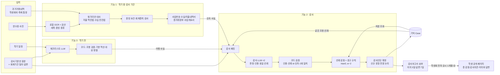

# Auditon PRD

Nov 7, 2026 · @coordit · 감사기준안 반영판 (기준: 한양대학교 정보시스템학과 감사기준안, 25.01.31. 제정 · 26.09.30. 개정)

> 이 문서에서 조항은 기준안 표기를 따른다. 예: **3부 35조**(회계기준), **4부 23조**(감사품질제고 규정), **2부 6.4**(개념체계). 판단 기준은 기준안 원문(`docs/감사기준안.md`, 원본 PDF)뿐이다.

## 1. 개요

Auditon은 학생회 재정을 **학기 전에는 기준안 체크리스트로 준비시키고, 학기 중에는 영수증을 모아 두고, 감사 기간에는 통장 거래내역과 헝가리안 알고리즘으로 맞춰 기준안 양식의 감사자료(사업개요서·수입/지출내역서·엑셀 장부)를 만든 뒤, LLM이 기준안 원문과 과거 감사 선례로 감사 초안을 쓰게 하는** 서비스다. 감사인단이 확정한 감사보고서는 학생회 집행부가 Auditon 공개 페이지로 전자 공시해(3부 70·71조) 일반 학생에게 학과별 **총 감점과 감점 사유, 감사의견, 이의와 답변**으로 공개된다.

### 두 개의 화면 영역

| 영역 | 사용자 | 하는 일 |
| --- | --- | --- |
| 관리자(admin) | 학과 학생회 집행부(학생회장·회계 담당), 감사위원회(감사인단) | 체크리스트, 영수증·통장 업로드, 감사자료 생성, 감사 판단 실행·검토·확정, 감사보고서 송부, 이의 답변 기록, (학생회) 전자 공시 |
| 학생 공개 페이지 | 일반 학생(학생회 회원) | 학과별 총 감점·경고 횟수, 감점 사유와 근거 조항, 감사의견 4가지 평가, 이의 내용과 답변, 회계기간별 추이 |

### 핵심 기능 3가지 + 공개

| # | 기능 | 언제 | 입력 | 출력 |
| --- | --- | --- | --- | --- |
| 1 | 영수증 수집과 감사자료 자동 생성 | 학기 중 수집, 감사 기간 생성 | 영수증 사진(수시), 통장 과거거래내역 엑셀(학생회비 통장, 축제 별도 통장) | 영수증 메타데이터(세목·증빙 종류), 대사 결과, 사업번호, 수입/지출내역서, 엑셀 장부(사업목록·총거래장부), 사업개요서 초안 |
| 2 | LLM 감사 판단 | 감사 기간 | 기준안 원문, 해당 회계기간 질의·답변, 감사자료, 대사·규칙 검사 결과, 체크리스트 이행 기록, 과거 감사 사례(기억) | 조항별 판정과 근거 인용, 동일 선례, 신규 유형 표시, 확인 질문 → 코드가 처분·총 감점 계산 → 감사보고서 초안 |
| 3 | 학기 일정 기반 기준안 체크리스트 | 학기 시작 전 | 학기 일정(공동구매, MT, 축제 부스 등) | 행사별 준비 자료·절차와 근거 조항, 감사위원회 승인·제출 사항 |
| 공개 | 학생 공개 페이지 (학생회 전자 공시) | 감사의견 공시 후 1개월 이내 | 감사인단이 확정한 감사보고서 | 학과별 총 감점·감사의견·이의와 답변 페이지 |

LLM은 두 곳에서 쓰이며 **서로 분리된다.** 체크리스트를 만드는 LLM(기능 3)과 감사를 판단하는 LLM(기능 2)은 모델·프롬프트·입력이 다르고 서로의 출력을 기준으로 삼지 않는다(5.4절).

### 한 줄 요약

미리 알려주고(체크리스트), 미리 모아 두고(영수증), 감사는 LLM이 기준안과 선례로 초안을 쓰고 감점은 선례에서 코드가 가져오며 감사인단이 확정하고, 결과는 학생에게 공개한다.

### 배경과 문제

- **영수증과 통장 맞추기:** 결산 때 영수증 더미와 과거거래내역서를 한 줄씩 맞추고 기준안 양식(수입/지출내역서, 총거래장부)에 옮겨 적는다. 영수증을 잃어버리거나, 세목이 없는 영수증을 받거나, 칸이 밀리는 실수가 여기서 생긴다.
- **감사 인력 부족:** 감사인 몇 명이 정기감사마다 최소 20시간(4부 9조)을 들여 증빙을 기준안과 대조한다. 기준안은 "종전 감사의 동일 사례 감점 기준을 우선 따른다"(4부 23조)고 정하지만, 지난 감사에서 어떤 사례를 몇 점으로 처리했는지는 사람 기억에 의존한다.
- **사전 절차 누락:** 축제 별도 통장은 사용 전에 통장 사본을 감사위원회에 전달하고 승인받아야 하고(3부 18조), 세목 표기가 안 되는 업체와 거래하면 계산서 6항목이 필요한데(3부 35조), 사업이 끝난 뒤에야 알게 된다.
- **결과가 학생에게 닿지 않음:** 감사보고서 공시와 이의·답변은 기준안상 의무지만(4부 21·22조, 3부 70·71조), 학생이 찾기 어렵고 감점 이유를 알기 어렵다.

**현장 근거 (발표 전 확보):**

- [ ] 최근 감사의 지적 유형별 건수와 처분(감점·경고) 분포 (감사위원회 기록, 건수만 집계하고 조직명은 비공개)
- [ ] 증빙 요건(3부 31~35조) 미충족·사전 승인 누락 지적 건수
- [ ] 회계 담당의 감사자료 작성 소요 시간, 감사인 1명이 학과 하나를 보는 데 걸리는 시간

### MVP 범위

| 항목 | MVP에서 다루는 범위 |
| --- | --- |
| 학과 | 시연용 가상 학과 3개. 기준은 정보시스템학과 감사기준안 1개 |
| 영수증·통장 | 가상 영수증 30~50장(로컬 OCR), 1개 은행 과거거래내역 양식, 학생회비 통장 + 축제 별도 통장 |
| 감사자료 양식 | 기준안 양식: 사업개요서(3부 39~48조), 수입/지출내역서(3부 49~55조), 엑셀 장부 1·2시트(3부 56~59조) |
| 감사 대상 자료 | 기준안 감사자료(3부 60조): 사업개요서, 과거거래내역서, 통장사본, 이체내역서·단체간거래확인서·계산서 등 증빙, 엑셀 장부 + 해당 회계기간 질의·답변 (모두 가상) |
| 기억 | 가상 과거 감사 사례 2개 회계기간 분량 |
| 범위 밖 | 은행 계좌 직접 연동, 예산 예측, 기준안 정합성 검증, 학교 시스템 연동, 실제 학생 데이터 공개, 징계(감사위원회 권한 밖, 2부 9.1) |

### 목표

1. **영수증을 미리 모으게:** 사진 한 장이면 일시·업체·금액·세목·증빙 종류가 저장되고, 감사 기간에는 통장과 자동으로 맞춰진다.
2. **감사자료 자동 생성:** 대사 결과로 사업번호를 붙이고 기준안 양식의 수입/지출내역서·엑셀 장부·사업개요서 초안을 만들며, 증빙 요건 미충족과 회계총칙 위반 후보를 알려준다.
3. **LLM 감사 판단:** 기준안 원문, 해당 회계기간 질의·답변, 과거 감사 사례를 함께 주고 감사자료를 조항별로 판단하게 한다. LLM은 판정과 "어느 선례와 동일한지"만 근거와 함께 답하고, 코드가 인용을 검증한 뒤 **선례의 처분을 그대로 가져와** 총 감점을 계산한다. 선례가 없으면 신규 유형으로 감사인단 전원 논의에 넘긴다(4부 24조). 확정은 감사인단이 한다.
4. **사전 체크리스트:** 학기 일정만 넣으면 별도의 LLM이 기준안에서 행사별 준비 자료·승인 절차를 뽑고, 코드가 기한과 선후를 계산한다.
5. **학생 공개:** 학생회가 감사인단에게서 받은 감사보고서를 전자 공시하는 페이지로(3부 70·71조), 학과별 총 감점, 감점 사유, 감사의견 4가지 평가, 이의와 답변으로 보여준다.

### 성공 지표 (목표치, 평가용 데이터로 1회 측정)

| 지표 | 목표 | 측정 방식 |
| --- | --- | --- |
| 영수증 인식 | 금액 98%, 일시 95%, 업체 90% 이상 정확 | 평가용 영수증 필드별 정답 비교 |
| 세목 유무 인식 정확도 | 95% 이상 | 영수증별 "세목 표기 있음/없음"과 증빙 종류 정답 비교 (3부 31·32·35조 판단의 입력) |
| 대사 자동 확정 정확도·비율 | 정확도 98% 이상, 비율 80% 이상 | 평가용 정답 쌍 |
| 감사자료 변환 | 수입/지출내역서·총거래장부 셀 단위 일치율 99% 이상 | 정답 파일과 셀별 비교 |
| 감사 판정 일치 | 조항별 판정이 감사인 판정과 85% 이상 일치 | 평가용 결산 사례 10건 |
| 동일 사례 매칭 일치율 | 85% 이상 | LLM이 고른 same_case(또는 신규 유형)가 정답 선례와 같은 비율 |
| 총 감점 일치 | 10건 중 8건 이상 정확히 일치 | 정답 총 감점(사례 감점 합 + 경고 감점)과 비교, 신규 유형은 제외하고 별도 집계 |
| 인용 정확도 | LLM이 인용한 근거 문장이 실제 서류에 있는 비율 100% (없으면 자동으로 확인 필요) | 코드 검증 |
| 판정 안정성 | 같은 입력 2회 호출 시 조항별 판정 일치 95% 이상 | 반복 호출 |
| 체크리스트 | 정답 준비 목록 대비 재현율 95% 이상, 기한 오차 0 | 가상 학기 일정 3개 |
| 공개 페이지 이해도 | 학생 5명 중 4명이 "우리 과가 왜 감점됐는지 알겠다" | 시연 후 설문 |

가중치·임계값·프롬프트는 조정용 데이터에서만 정하고, 평가용 데이터는 개발이 끝난 뒤 한 번만 돌린다(10절).

## 2. 사용자와 시나리오

### 페르소나

| 사용자 | 기준안상 책임 | 상황 | 필요한 것 | 쓰는 화면 |
| --- | --- | --- | --- | --- |
| 과 학생회 회계 담당 (회계·재무 부서의 장) | 회계 보고서 작성에 대한 **제한적 책임** (2부 8.2) | 영수증 관리와 감사자료 작성을 혼자 맡는다 | 영수증을 잃어버리지 않고, 결산 때 손으로 맞추지 않기 | 관리자: 영수증, 대사·감사자료, 체크리스트 |
| 과 학생회장 (감사대상의 장) | 회계 보고에 대한 **전반적 책임** (2부 8.1), 원본대조필 확인 (3부 64조) | 학기 사업을 정한다 | 사업마다 지킬 절차와 사전 승인을 미리 알기 | 관리자: 체크리스트, 이의 제기, 전자 공시 |
| 감사인 (감사위원회) | 비밀유지 의무 (4부 5조), 최소 감사시간 준수 (4부 8~12조) | 인력은 적고 학과는 많다 | 감사자료를 기준안과 대조한 초안과 동일 선례를 받아 판단에만 집중 | 관리자: 감사 판단·검토·확정, 감사보고서 |
| 일반 학생 | — | 학생회비를 냈다 | 우리 과가 돈을 잘 썼는지, 감점됐다면 왜인지 | 학생 공개 페이지 |

### 사용자 스토리

- 회계 담당으로서, 결제할 때마다 영수증을 찍어 올리면 세목과 증빙 종류까지 저장되길 원한다.
- 회계 담당으로서, 감사 기간에 과거거래내역 엑셀만 올리면 영수증과 맞춰져 기준안 양식의 수입/지출내역서와 엑셀 장부가 나오길 원한다.
- 학생회장으로서, 학기 일정을 넣으면 사업마다 준비할 증빙과 감사위원회 승인 사항을 알고 싶다.
- 감사인으로서, 조항마다 충족·미충족이 근거 문장과 동일 선례와 함께 정리된 초안을 보고, 고쳐서 확정하고 싶다.
- 일반 학생으로서, 우리 과와 다른 과의 감점 사유, 감사의견, 학생회의 이의와 그 답변을 쉽게 보고 싶다.

### 대표 시나리오: 한 회계기간의 처음과 끝

1. **학기 전 (기능 3):** 학생회장이 "3월 과잠 공동구매(수금 120명), 4월 MT, 5월 축제 부스(별도 통장 사용)"를 입력한다. 체크리스트 LLM이 기준안에서 해당 의무를 뽑고, 코드가 선후와 기한을 계산해 보여준다.
   - 과잠: "학생회비 통장으로 수취(3부 11조), 수입 구분(참가비/사업수익금)은 감사위원회에 질의 권장(3부 12조, 2부 4.3·5)"
   - MT: "참가비 ≤ 사업 지출(3부 13조), 예약금은 이체내역서 보관(3부 32조의 2)"
   - 축제: "**사용 전** 통장 사본 전달·승인(3부 18조), 별도 엑셀 장부(3부 20조), 비정기감사 요청 여부 결정(3부 21조)"
2. **학기 중 (기능 1):** 회계 담당이 결제할 때마다 영수증을 찍어 올린다. OCR이 일시·업체·금액·세목·증빙 종류를 읽고, 세목이 없으면 "계산서 6항목 필요(3부 35조)"를 바로 알려 준다. 체크리스트 항목은 완료할 때마다 체크하고 자료를 첨부한다.
3. **감사 기간 (기능 1):** 학생회비 통장과 축제 통장의 과거거래내역 엑셀을 올린다. 지출은 역진법(모든 출금 → 증빙), 수입은 전진법(모든 입금 → 장부·수입 구분)으로 맞춘다(2부 6.4). 증빙 없는 출금 2건, 어느 사업에도 안 붙은 입금 1건(미분류 수입)이 표시된다. 확인을 마치면 사업번호가 붙은 수입/지출내역서, 엑셀 장부, 사업개요서 초안이 만들어진다.
4. **감사 (기능 2):** 감사인이 감사 판단을 실행한다. 시스템이 사업별로 감사 패킷(관련 기준안 조항 원문, 해당 회계기간 질의·답변, 그 사업의 감사자료·규칙 검사 결과, 체크리스트 이행 기록, 같은 조항의 과거 사례)을 만들어 감사 LLM에 보낸다. LLM은 조항마다 충족·미충족·확인 필요와 동일 선례를 근거 문장과 함께 돌려준다.
5. 코드가 인용을 검증하고 처분을 계산한다.
   - 축제 부스 계산서에 ③ 견적 산출 근거 누락(3부 35조) → 동일 선례 처분 **−1점**
   - 할부 결제 1건(3부 8조), 포인트 적립 1건(3부 9조), 근거 비고 없는 전용 처리(3부 27조) → 선례 처분 **경고 3회** → 경고 감점 max(0, 3 − 2) = **1점**
   - MT 참가비가 지출 초과(3부 13조) → 선례 없음 → **신규 유형: 감사인단 전원 논의**(4부 24조), 감점 비움
   - 초안 총 감점: **2점 + 신규 유형 1건 논의 중**
6. 감사인단이 신규 유형을 논의해 처분을 정하고, 감사의견 4가지 평가를 다듬어 확정한다. 감사보고서는 감사 종료 후 3일 이내 송부되고(4부 19조), 학생회는 3일간 이의를 낼 수 있으며(4부 20조), 감사인단은 송부 후 7일 이내 답변하고 전문을 공시한다(4부 21조). 학생회는 이의·답변이 담긴 확정 감사보고서를 받아 1개월 안에 Auditon 공개 페이지로 전자 공시한다(3부 70조). 확정 결과는 기억(Case)에 저장되어 다음 감사의 감점 기준이 된다.
7. **공개:** 일반 학생이 공개 페이지에서 학과별 총 감점을 보고, 우리 과를 눌러 감점 사유·근거 조항·감사의견·이의와 답변을 확인한다.

### 사용자 흐름

```
[관리자] 기준안 등록 → 과거 감사 사례(선례)·질의·답변 등록 → 학기 일정 → 체크리스트 이행
       → 영수증 수시 업로드 → (감사 기간) 통장 업로드 → 대사 확인 → 감사자료(내역서·장부·사업개요서)
       → 감사 판단 실행 → 초안 검토 → 신규 유형 논의 → 확정 → 감사보고서 송부 → 이의·답변 기록 → (학생회) 전자 공시
[학생]  공개 페이지 → 학과 목록(총 감점·경고 횟수) → 학과 상세(감점 사유·근거 조항·감사의견·이의와 답변·회계기간별 추이)
```

## 3. 기능 요구사항

P0가 시연의 전부다. P1은 시간이 남을 때만 만들고, P2는 발표 마지막 로드맵 한 장에만 올린다.

| ID | 기능 | 설명 | 핵심 기술 | 우선 |
| --- | --- | --- | --- | --- |
| F0 | 기준안·선례·질의 등록 | 기준안 원문을 부·조·항·호로 나누고(예: 3부 35조 ③, 2부 6.4), 감사 대상 조항을 고른다. 과거 감사 사례(Case)와 해당 회계기간 질의·답변(Inquiry)을 등록한다. 직전 회계기간까지의 **감점 기준 목록**을 선례에서 뽑아 감사대상에 제공한다(4부 25조) | 조항 파싱, 설정 화면 | P0 |
| F1-a | 영수증 업로드·OCR | 사진을 올리면 일시·업체·사업자번호·금액·세목·결제수단·할부·포인트 적립 표기를 읽고, 증빙 종류(카드 전표/현금영수증/표준·특수 영수증/계산서 등)와 세목 유무를 판정. 사업 태그 | 로컬 OCR + 자기 검산 | P0 |
| F1-b | 통장 거래내역 읽기·가명처리 | 1개 은행 과거거래내역 엑셀을 표준 거래로 바꾸고(통장내역 문구는 원문 그대로 보존, 3부 51조) 이름·계좌를 코드화. 학생회비 통장/축제 별도 통장 구분 | 은행 양식 파서, HMAC + 암호화 매핑표 | P0 |
| F1-c | 영수증↔출금 대사 | 지출은 역진법, 수입은 전진법(2부 6.4). 전체 최적 매칭, 애매하면 확인 필요, 나눠·묶음 결제는 부분집합 합. 사업에 안 붙은 입금은 미분류 수입 | 헝가리안 + 점수 차 확인 + 부분집합 합 | P0 |
| F1-d | 감사자료 생성 | 수입·지출 구분(3부 12·16조), 사업번호(3부 37·38조), 수입/지출내역서(3부 49~55조), 엑셀 장부 1시트 사업목록·2시트 총거래장부(3부 56~59조), 사업개요서 자동 칸(3부 44·46조). 잔액·합계 검산 | 규칙 분류 + TemplateSpec + openpyxl | P0 |
| F1-e | 증빙 요건·회계총칙 검사 | 지급 방법별 필요 증빙(3부 29~36조)이 갖춰졌는지, 할부(3부 8조)·포인트 적립(3부 9조)·참가비 초과(3부 13조)·수수료 처리(3부 14·17조)·전용 비고(3부 27조)를 코드로 검사. 비정기감사로 이미 수검한 증빙은 제외(2부 7, 3부 22·23조) | 규칙 표 | P0 |
| F2-a | 감사 패킷 구성 | 사업별로 관련 조항 원문, 해당 회계기간 질의·답변, 감사자료 텍스트(가명), 규칙 검사 결과, 체크리스트 이행 기록, 기억에서 고른 같은 조항의 과거 사례를 묶는다 | 코드 (조항·사업 매핑, 선례 검색) | P0 |
| F2-b | 감사 LLM 호출 | 패킷을 감사 LLM에 보내 조항별 판정·근거 인용·동일 선례·신규 유형 여부·확인 질문을 JSON으로 받는다. **감점 점수는 받지 않는다.** 사업별 1회 + 학과 전체 1회, 각 2회 호출 | LLM API, 구조화 출력 | P0 |
| F2-c | 판정 검증·처분 계산 | 인용 문장·조항·선례 id 실존 확인, 숫자 주장은 감사자료와 대조, 2회 판정·선례 불일치는 확인 필요. 동일 선례의 처분(감점 n점/경고)을 가져오고, 경고 감점 = max(0, w − 2), 총 감점 = 사례 감점 합 + 경고 감점 | 코드 | P0 |
| F2-d | 기억 (Case) | 확정된 과거 감사 사례 저장·검색: 학과, 회계기간, 조항, 사례 유형 태그, 사례 설명, 처분, 판단 사유, 이의 여부 | DB + 조항 id 일치 + 텍스트 유사도 | P0 |
| F2-e | 초안 검토·확정·감사보고서 | 감사인이 판정·처분을 수정하고 신규 유형은 전원 논의 결과를 입력해 확정. 감사보고서 초안(4부 17조)과 감사의견 4가지 평가(4부 18조) 작성. 확정 결과는 기억에 저장 | 화면, 이력 | P0 |
| F2-f | 송부·이의 기록 | 감사보고서 송부, 이의 접수 3일·답변 7일 기한 표시(4부 19~21조). 이의와 답변은 감사인이 감사보고서에 기록하고, 공개 페이지에 반드시 표시(4부 22조) | 상태 관리, 기한 계산 | P0 |
| F3 | 학기 일정 체크리스트 | 체크리스트 LLM이 기준안에서 행사별 의무를 뽑고, 코드가 조항 실존 확인·기한 역산·선후 정렬. 이행 체크·첨부 | 별도 LLM + 위상 정렬 | P0 |
| F4 | 학생 공개 페이지 (학생회 전자 공시) | 학생회 집행부가 확정 감사보고서를 게시. 학과별 총 감점·경고 횟수, 감점 사유·근거 조항, 감사의견 4가지 평가, 이의와 답변, 회계기간별 추이. 누구나 접근, 수정 불가, 5년 보관(3부 70·71조) | 공시된 결과만 | P0 |
| F2-g | 이의 접수 화면 | 학생회가 Finding별로 직접 이의를 제기하고 감사인이 화면에서 답변. 기한 알림. P0에서는 감사인이 이의·답변을 텍스트로 기록 | 상태 관리 | P1 |
| F5 | 감사 품질 확인 | 감사시간 기록: 정기 최소 20시간, 비정기 10시간, 감사인 1인 2시간 이상, 선임위원 합계 ≥ 최소 시간의 1/2 (4부 8~12조) | 집계 | P1 |
| F6 | 감사자료 묶음 PDF, 체크리스트 ICS | 제출 순서(표지 → 원본대조필 → 사업개요서 → 통장사본 → 과거거래내역서 → 수입/지출내역서와 증빙 → 특이사항, 3부 65조)대로 묶은 인쇄용 PDF, 캘린더 내보내기 | HTML → PDF, ICS | P1 |
| F7 | 예산 예측, 기준안 정합성 검증, 중앙 관제, 인수인계 | 확장 | 몬테카를로, Z3, 집계 | P2 |

범위 밖: 은행 계좌 직접 연동, 실제 결제·송금, 학교 시스템(HY-in) 연동, 감사인단의 최종 판단 대체, 징계(2부 9.1).

## 4. 데이터

기준안은 실제 원문을, 영수증·통장·감사자료·과거 감사 기록·질의·답변·학기 일정은 기준안 양식을 본뜬 가상 데이터를 쓴다. 실제 장부와 실제 학생 데이터는 해커톤에 쓰지 않는다.

### 데이터 출처와 활용

| 데이터 | 출처·확보 방법 | 활용 | 주의점 |
| --- | --- | --- | --- |
| 감사기준안 원문 | 정보시스템학과 감사위원회 (26.09.30. 개정본, `docs/`) | 감사 판단과 체크리스트의 유일한 기준, 근거 인용 | PDF 자동 추출 텍스트이므로 인용은 PDF와 대조. 발표 사용 전 감사위원회에 공유 |
| 질의·답변 | 가상 (해당 회계기간 감사대상 질의와 감사인단 답변) | 감사 패킷. 기준안과 같은 지위, 충돌 시 기준안 우선(4부 15조) | 회계기간별로 분리 |
| 과거 감사 사례(선례) | 실제 감사보고서 형식을 본뜬 가상 기록 2개 회계기간 | 기억, 감점 기준(4부 23조) | 실제 기록은 형식만 참고. 처분 값은 시연용임을 밝힘 |
| 감사자료 | 기준안 양식(사업개요서·수입/지출내역서·엑셀 장부)을 본뜬 가상 자료 | 감사 판단 입력 | 실제 학생회 자료는 쓰지 않음 |
| 영수증·증빙 이미지 | 직접 만든 가상 영수증·계산서·이체내역서·단체간거래확인서 + 개인정보를 가린 팀원 영수증 | OCR, 시연 |  |
| 통장 거래내역 | 1개 은행 과거거래내역 양식을 본뜬 가상 파일 (학생회비 통장, 축제 별도 통장) | 대사 입력 |  |
| 엑셀 장부 양식 | 감사위원회 제시 양식(3부 56조) | 출력 템플릿 | 양식은 바꾸지 않고 값만 채움. 3~5시트는 작성하지 않음(3부 59조) |
| 학기 일정 | 가상 학기 3개 | 기능 3 입력·평가 |  |

### 데이터 모델

| 엔티티 | 핵심 필드 | 설명 |
| --- | --- | --- |
| Clause | id(예: `3부-35조-③`, `2부-6.4`), 부, 조, 항·호, 원문, 감사 대상 여부 | 판단과 인용의 단위. 감점 값은 갖지 않는다 |
| Inquiry | 회계기간, 질의 내용, 답변, 답변일, 관련 조항 id\[\] | 기준안과 같은 지위의 해당 기간 해석(4부 14·15조) |
| Case (기억) | 학과, 회계기간, 조항 id, 사례 유형 태그, 사례 설명, 처분(감점 n점 / 경고), 판단 사유, 이의 여부 | 확정된 과거 사례. 감점 기준의 출처(4부 23조) |
| Project | 사업번호, 사업명, 구분(학생회비 0·관리운영비 97·소모품비 98·사업무관거래 99·감사비용 100 고정, 나머지 1부터), 사업개요서 칸(대상, 참가인원 집행부/전체, 사업내용, 수입·지출 적요, 수입·지출 총액, 비고) | 3부 37~48조 |
| Receipt | 일시, 업체, 사업자번호, 금액, 세목\[\], 세목 유무, 증빙 종류, 결제수단(카드 끝 4자리), 할부 개월, 포인트 적립 표기, 계산서 6항목 체크, 필드별 신뢰도, 사업 태그, 암호화 원본 경로 | 학기 중 모은 증빙 |
| Transaction | 통장(학생회비/축제), 일자, 통장내역 원문, 입금/출금, 금액, 잔액 | 과거거래내역 한 줄 |
| Match | 거래 id\[\], 증빙 id\[\], 점수, 상태(자동 확정/확인 필요/증빙 없음/미분류 수입/통장에 없는 영수증) | 대사 결과 |
| Entry | 사업-일련번호(예: `2-7`), 일자, 통장내역, 내용, 수입·지출 구분, 세목, 금액, 지급방법, 증빙종류, 증빙서류, 비고 | 수입/지출내역서·총거래장부 한 줄 |
| RuleCheck | 대상(거래·증빙·사업), 조항 id, 결과, 근거 값 | 코드 검사 결과(증빙 요건, 할부, 포인트, 참가비 초과 등) |
| AuditedEvidence | 증빙 id, 감사 종류(비정기), 감사보고서 id | 이중감사 제한(2부 7, 3부 22·23조) |
| Event / Obligation | 행사 / 할 일, 근거 조항, 기한, 선행, 상태, 첨부 | 체크리스트와 이행 기록 |
| AuditPacket | 사업, 조항 id\[\], 질의 id\[\], 자료 id\[\], Entry 행, RuleCheck\[\], 이행 기록, 선례 Case id\[\] | LLM에 보내는 입력 묶음 |
| Judgment | clause, target, verdict, evidence\[{doc, quote}\], missing\[\], same\_case{case\_id, why}, is\_new\_type, question, 호출 회차, 검증 결과 | LLM 판정 한 건 |
| Finding | clause\_id, 최종 판정, 처분(감점 n / 경고 / 신규 유형 논의 중 / 없음), 처분 출처(Case id 또는 감사인단 논의), 근거 사슬, 상태(초안·수정·확정) | 감사 초안·확정 결과 한 항목 |
| AuditReport | 감사대상과 책임자, 감사 수행 범위·기간, 총 감사시간·선임위원 감사시간, 질의와 답변, 감사의견 4가지 평가(평가별 양호/미흡 + 한두 문장 사유), 서명, 송부일, 이의 마감, 답변 마감, 공시일 | 4부 17~21조 |
| Objection | 감사보고서 id, Finding id, 이의 내용, 답변, 접수·답변 시각 | 4부 20~22조 |
| PublishedResult | 학과, 회계기간, 총 감점, 사례 감점 합, 경고 횟수·경고 감점, 공개용 감점 사유\[\](근거 조항 포함), 감사의견 4가지 평가, 이의·답변\[\], 공시 주체(학생회 집행부)·공시일·보관 만료일(5년) | 학생 공개 페이지 데이터 (수정 불가) |
| CodeMap / AccessLog | 코드↔암호화 실명 / 열람자·사유·시각 | 재식별 매핑표와 열람 기록 |

### 가상 데이터: 조정용과 평가용을 나눈다

생성기는 정답(영수증 필드·세목 유무·증빙 종류, 대사 정답 쌍, 정답 수입/지출내역서·총거래장부, 정답 체크리스트, 사업별 조항 정답 판정·동일 선례·처분·총 감점)을 함께 낸다. 판정·처분 정답은 감사인이 매긴다.

| 세트 | 구성 | 쓰임 |
| --- | --- | --- |
| 조정용 | 영수증 30장, 거래 약 100건, 결산 사례 5건, 학기 1개, 과거 사례 1개 회계기간 | 가중치·임계값·프롬프트 조정 |
| 평가용 | 영수증 20장, 거래 약 100건, 결산 사례 10건, 학기 2개, 과거 사례 1개 회계기간 | 개발이 끝난 뒤 한 번만 돌려 성공 지표 측정 |

포함할 경우:

- 대사: 같은 날 같은 금액 두 건, 나눠·묶음 결제, 대사 점수 0.4 경계, 흐린 영수증, 증빙 없는 출금, 미분류 입금
- 증빙: 세목 없는 영수증(계산서 6항목 일부 누락), 예약금과 환급, 단체간거래, 비사업자 현금 지급
- 수입·회계총칙: 수수료 포함 수입, 참가비가 지출을 초과하는 사업, 할부 결제, 포인트 적립, 근거 비고가 없는 전용 처리
- 축제: 별도 통장 미승인, 비정기감사로 이미 수검한 증빙
- 판단: 선례가 있는 사례와 신규 사례, 선례 처분이 서로 다른 사례, 질의·답변으로 해석이 정해진 사례
- 경고: 경고 2·3·4회

## 5. 알고리즘과 로직

숫자로 판단할 수 있는 것(대사, 증빙 유무, 잔액, 참가비 ≤ 지출, 기한, 감점 합산)은 코드가 하고, 감사자료를 기준안에 비추어 읽는 일과 선례와의 동일성 판단은 LLM 호출이 한다. LLM 호출은 정해진 순서로 한 번씩 이뤄지며 스스로 다음 행동을 고르지 않는다(에이전트 방식이 아님). 토큰은 더 쓰지만 구조가 단순하고 결과를 추적하기 쉽다.

### 5.1 기능 1: 영수증 수집과 감사자료

**① 영수증 인식 (학기 중).** 서버 안의 로컬 OCR로 일시, 업체명, 사업자번호, 금액, 세목, 결제수단, 할부·포인트 표기를 뽑고 자기 검산한다(세목 합 = 합계, 공급가액 + 부가세 = 합계, 날짜·사업자번호 형식). 검산이 맞지 않거나 신뢰도가 낮은 칸은 노란색으로 표시하고 올린 사람이 고친다. 세목이 없으면 계산서 6항목 체크 화면을 띄운다.

**② 증빙 요건 (3부 29~36조).** 지급 방법별로 필요한 증빙이 모두 있는지 코드가 검사한다.

| 거래 | 필요한 증빙 | 근거 |
| --- | --- | --- |
| 카드 지출 | 세목이 표기된 카드 전표 | 3부 31조 |
| 계좌이체 지출 | 세목이 표기된 현금영수증 | 3부 32조 |
| 예약금 지출(추후 환급) | 과거거래내역서 + 이체내역서 | 3부 32조의 2 |
| 비사업자 현금 지급 | 표준/특수 영수증 + 이체내역서 + 과거거래내역서 | 3부 33조 |
| 비사업자 현물 지급 | 표준/특수 영수증, 현물 구입 지출내역서에 포함 | 3부 34조 |
| 단체간거래 지출·수입 | 과거거래내역서 + 이체내역서 + 단체간거래확인서 | 3부 33조의 2, 30조의 2 |
| 세목 표기가 불가능한 업체 | 총액 영수증 + 계산서 6항목: ① 업체·책임자 이름·서명 ② 책임자 연락처 ③ 견적 산출 근거(세목) ④ 집행부 담당자 이름·서명·연락처 ⑤ 일자·수단·총액 ⑥ 문서 조작 법적 책임 경고와 담당자 서명 | 3부 35조 |
| 정부가 신뢰성을 보증하는 비영리법인 계산서 | 카드 전표·영수증을 온전히 대체 | 3부 36조 |
| 계좌이체 수입 | 과거거래내역서 (계약·협약 수입은 계약서 등) | 3부 29조 |
| 현금 수입 | 표준/특수 영수증 + 과거거래내역서 | 3부 30조 |

**③ 회계총칙 검사 (코드).** 카드 결제 원칙(3부 7조, 계좌이체·현금은 사유와 증빙 확인), 할부 금지(3부 8조), 포인트 적립 금지·캐시백은 학생회비에 산입(3부 9조), 참가비 ≤ 해당 사업 지출(3부 13조), 수입 수수료는 차감한 순액(3부 14조), 지출 수수료는 지출에 가산(3부 17조), 전용 시 산출 근거 비고(3부 27조). 결과는 RuleCheck로 저장되어 감사 패킷의 숫자 사실이 된다.

**④ 통장 거래내역 읽기 (감사 기간).** 은행 양식 파서로 읽고, 통장내역 문구는 원문 그대로 보존하며(3부 51조) 적요의 이름·계좌번호를 바로 코드로 바꾼다. 축제 별도 통장은 학생회비 통장에 준해 같은 방식으로 감사한다(3부 18조).

**⑤ 영수증↔거래 대사.** 방향은 기준안을 따른다(2부 6.4).

- **지출 — 역진법:** 모든 출금에서 출발해 증빙을 찾는다. 증빙이 없으면 "증빙 없음".
- **수입 — 전진법:** 모든 입금에서 출발해 장부 기록과 수입 구분을 확인한다. 어느 사업에도 안 붙은 입금은 "미분류 수입".

영수증 m장과 출금 n건을 짝짓되 짝 전체의 비용 합이 가장 작게 한다.

`s(i,j) = w_a·S_amt + w_d·S_date + w_m·S_name` (시작값 w\_a 0.5, w\_d 0.2, w\_m 0.3, 조정용 세트로만 조정)

짝지은 비용은 `c(i,j) = 1 − s(i,j)`. 행렬을 (m+n)×(m+n)으로 늘리고 미매칭 비용을 한쪽당 `δ = (1 − s_min) / 2 = 0.3`(s\_min = 0.4), 더미끼리는 0으로 두면 **s > 0.4일 때만 짝을 짓는다.** 날짜 차이 7일 초과나 금액 차이 50% 초과는 큰 비용으로 막고, scipy `linear_sum_assignment`로 푼다. s ≥ 0.85이고 2위 후보와 점수 차 ≥ 0.1이며 이 쌍을 금지했을 때 총비용이 Δ 이상 늘 때만 자동 확정하고, 아니면 이유와 함께 "확인 필요"로 보낸다. 남은 미매칭 중 합이 맞는 조합(1:N, N:1)은 부분집합 합으로 찾아 항상 확인 필요로 보낸다. 예약금과 그 환급, 결제 취소는 짝으로 묶어 각각 지출·수입의 "취소" 구분 후보로 표시한다. 결과는 자동 확정, 확인 필요, **증빙 없음**, **미분류 수입**, **통장에 없는 영수증**이다.

**⑥ 이중감사 제한.** 비정기감사로 이미 수검한 증빙(AuditedEvidence)은 정기감사 대사·검사에서 제외하고 "기수검"으로 표시한다. 별도 통장으로 비정기감사를 받은 축제 회계는 통째로 제외한다(2부 7, 3부 22·23조).

**⑦ 감사자료 생성.**

- **수입·지출 구분:** 수입은 학생회비/참가비/사업수익금/예금결산이자/기타/취소(3부 12조), 지출은 사업수행비/관리운영비/소모품비/감사비용/기타/취소(3부 16조). 세목·업체 업종·사업 태그로 규칙 분류하고, 애매하면 확인 필요.
- **사업번호:** 학생회비 0, 관리운영비 97, 소모품비 98, 사업무관거래 99, 감사비용 100은 고정, 나머지 사업은 발생 순서대로 1부터(3부 37·38조).
- **수입/지출내역서:** "(사업번호)-(일련번호)"(예: 2-7), 통장내역(원문 그대로), 내용, 세목(영수증 표기 그대로, 지출 수수료는 별도 세목, 수입은 수수료 차감 순액), 지급방법, 증빙종류, 증빙서류(3부 49~55조).
- **엑셀 장부:** 1시트 '사업목록', 2시트 '총거래장부' — 첫 행은 전기 이월을 수입으로, 이후 발생 순으로 일자·사업번호·통장내역·거래내용·수입/지출액·결제수단·비고. 현금흐름이 없는 전용 거래는 비고에 "현금의 유입과 유출이 없는 거래". 3~5시트는 작성하지 않는다(3부 56~59조). 축제 별도 통장은 별도 장부(3부 20조).
- **사업개요서:** 수입 총액과 지출 총액(교비 제외)은 자동으로 채우고, 대상·참가인원(집행부/전체)·사업내용·적요·비고는 집행부가 작성한다(3부 39~48조).
- 잔액 연속성과 총계를 검산한 뒤 TemplateSpec에 따라 정해진 셀에 값을 넣는다. 서식과 수식은 유지한다.

**⑧ 제출 방식.** 기준안의 원칙은 인쇄·제본한 사본에 원본대조필 도장을 찍어 제출하는 것이고(3부 62~65조), 엑셀 장부만 수정 방지 조치를 한 전자 문서로 낸다(3부 66조). Auditon은 제출 순서대로 묶은 인쇄용 PDF를 만들어 주고(F6, P1), 전자 제출을 인정할지는 감사위원회의 기준안 개정 사항으로 둔다.

### 5.2 기능 2: LLM 감사 판단

감사인이 실행 버튼을 누르면 아래 단계가 순서대로 한 번씩 돈다.

**① 감사 패킷 구성 (코드).** 사업마다 하나씩, 그리고 학과 전체(회계총칙·통장 운용·감사자료 형식 등 사업에 묶이지 않는 조항)용으로 하나 만든다.

| 패킷 구성 요소 | 내용 |
| --- | --- |
| 기준안 조항 | 감사 대상 조항 중 이 사업에 해당하는 것의 **원문 전체** |
| 질의·답변 | 해당 회계기간의 관련 질의와 답변. 기준안과 같은 지위, 충돌하면 기준안 우선(4부 15조) |
| 감사자료 | 이 사업의 사업개요서, 수입/지출내역서 행, 증빙 OCR 텍스트·계산서 항목 (가명처리) |
| 숫자 사실 | 대사 결과, RuleCheck(증빙 요건, 할부, 포인트, 참가비 ≤ 지출, 수수료 등), 기수검 증빙 목록 (기능 1 결과, 코드가 계산) |
| 이행 기록 | 체크리스트 의무별 완료 여부·첨부 (기능 3 결과, 사실로만 전달) |
| 기억 | 같은 조항의 과거 사례 상위 3건(학과·회계기간·사례 설명·처분·판단 사유) |

**② 감사 LLM 호출.** 패킷을 넣고, 조항마다 아래 형식으로만 답하게 한다(구조화 출력, temperature 0). 같은 패킷을 **두 번** 호출한다. **감점 점수는 출력하지 않는다.**

```json
{
  "clause": "3부 35조",
  "target": "사업 3 축제 부스 / 3-12 무대 장비 대여",
  "verdict": "미충족",
  "evidence": [{"doc": "계산서-3-12", "quote": "장비 대여 일체 450,000원"}],
  "missing": ["③ 견적 산출 근거(세목)"],
  "same_case": {"case_id": "2026-1-산업공학과-C04", "why": "세목 없는 업체 계산서에 견적 산출 근거가 빠진 사례"},
  "is_new_type": false,
  "question": null
}
```

프롬프트에는 다음을 고정한다: 판단 기준은 주어진 기준안 원문과 질의·답변뿐이며 충돌하면 기준안이 우선한다. 근거는 반드시 서류 문장을 그대로 인용한다. 서류에 없으면 "확인 필요"로 답한다. 선례는 "동일한 사례인지"를 판단하는 데만 쓰고 기준으로 삼지 않는다. 동일한 선례가 없으면 `is_new_type: true`로 답한다. 숫자 사실은 주어진 값을 그대로 쓴다. 감점은 매기지 않는다.

**③ 판정 검증 (코드).**

- 인용한 문장이 실제 서류에 있는지 문자열로 확인한다. 없으면 그 판정은 "확인 필요"로 바꾼다.
- 조항 id가 감사 대상 조항에 있는지, `same_case.case_id`가 기억에 실제로 있고 같은 조항인지 확인한다.
- 금액·날짜·건수 주장은 감사자료·RuleCheck와 대조한다. 숫자 판정(증빙 없음, 참가비 초과, 할부 여부)은 LLM 답과 상관없이 코드 결과를 쓴다.
- 두 번의 호출에서 판정이나 동일 선례가 다르면 "확인 필요"로 바꾸고 두 답을 모두 보여준다.

**④ 처분 계산 (코드).**

- **동일 사례가 있으면** 그 Case의 처분(감점 n점 또는 경고)을 그대로 가져온다(4부 23조). 동일 사례로 볼 선례가 여럿이고 처분이 다르면 가장 최근 것을 제안하고 차이를 표시한다.
- **신규 유형이면** 처분을 비워 두고 "신규 유형: 감사인단 전원 논의"로 표시한다(4부 24조). 시스템은 감점을 정하지 않는다.
- **경고:** 경고 횟수는 **회계기간마다 0부터 새로 센다.** 해당 회계기간 감사의 경고가 w회면 경고 감점 = `max(0, w − 2)` (4부 26조: 3회째 1점, 이후 1건마다 1점).
- **총 감점 = 사례별 감점 합 + 경고 감점.** "확인 필요"와 신규 유형은 확정 전까지 총 감점에 넣지 않고 따로 건수를 보인다.
- 등급(적정/한정 등)은 만들지 않는다. 기준안에 없다.

| 경고 횟수 w | 0 | 1 | 2 | 3 | 4 | 5 |
| --- | --- | --- | --- | --- | --- | --- |
| 경고 감점 | 0 | 0 | 0 | 1 | 2 | 3 |

**⑤ 검토·확정·기억 저장.** 감사인이 판정과 처분을 수정하고, 신규 유형은 감사인단 전원 논의 결과(감점 여부·수준)를 입력해 확정한다. 확정된 Finding은 Case로 기억에 저장되어 다음 감사의 감점 기준이 된다. 감사인이 자주 뒤집는 조항은 프롬프트·조항 해석 점검 대상으로 표시한다.

**⑥ 감사보고서 초안 (4부 17·18조).** 감사대상과 책임자, 감사 수행 범위, 감사 수행 기간, 총 감사시간과 선임위원 감사시간, 질의 내용과 답변, 감사의견, 감사인단 서명란을 채운다. 감사의견은 4가지 평가로 쓴다: ① 감사자료의 신뢰성 ② 회계관리 및 통제의 유효성 ③ 수입 및 지출의 종합적 적절성 ④ 회계 전반. 평가마다 짧은 판정(양호 / 미흡)과 한두 문장의 사유만 쓴다. 이 판정은 등급이 아니며, 자세한 내용은 감사위원회 피드백(이의·답변, 질의·답변)으로 보완된다. LLM은 Finding 목록을 바탕으로 초안만 쓰고, 감사인단이 고쳐 확정한다.

**⑦ 감사 후 절차 기한 (4부 19~22조, 3부 69·70조).** 감사 종료 후 3일 이내 보고서 송부, 송부일부터 3일간 이의 접수, 송부 후 7일 이내 답변 전달과 전문 공시. 공시물에는 이의 내용과 답변을 반드시 넣는다. 학생회는 감사의견 공시 후 1개월 이내 제본·전자 공시를 마친다. 화면에는 남은 일수 대신 마감 날짜를 보여주고, 마감이 다가오면 담당자에게 알린다.

**⑧ 감점 기준 목록 공개 (4부 25조).** 직전 회계기간까지의 Case에서 "조항 · 사례 유형 · 처분"을 뽑아 감사대상에 제공한다. 체크리스트 화면에서도 볼 수 있다.

**⑨ (P1) 감사 품질 확인 (4부 8~12조).** 감사인별 감사시간을 기록하고 정기 20시간·비정기 10시간, 1인 2시간 이상, 선임위원 합계 ≥ 최소 시간의 1/2을 확인한다.

**토큰 예산:** 패킷 하나는 조항 원문 2~5천, 감사자료 3~10천, 질의·선례·숫자 사실 2천 토큰 정도다. 사업 10개 + 학과 전체 1개를 2회씩 호출하면 학과당 약 30만~40만 입력 토큰이다. 비용은 들지만 호출 수가 정해져 있어 예측할 수 있다.

### 5.3 기능 3: 학기 일정 기반 기준안 체크리스트

1. **의무 추출 (체크리스트 LLM):** 학기 일정의 행사마다 기준안 원문을 넣고, 해야 할 일·근거 조항·기한 규칙·선행 항목을 JSON으로 받는다. 같은 행사 유형(예: 참가비 사업)은 한 번 감사인이 검수한 결과를 저장해 다음 학기에 재사용한다.
2. **검증 (코드):** 근거 조항이 실제로 있는지, 인용한 조항 문장이 원문에 있는지 확인한다. 없으면 그 항목은 "검수 필요"로 표시한다.
3. **기한 계산 (코드):** 선행 관계(예: 별도 통장 개설 → 통장 사본 전달 → 감사위원회 승인 → 통장 사용 시작)를 방향 그래프로 만들어 위상 정렬하고, 행사일에서 거꾸로 기한을 계산한다. `기한(의무) = min(규칙의 기한, 후속 의무의 기한 − 후속 의무의 소요일)`. 순환이 있으면 감사인에게 알린다. 기준안에 날짜가 정해진 것(회계기간, 감사 안내 공문, 공시 기한)은 기준안 날짜를 쓰고, 기준안이 "사용 전"처럼 순서만 정한 것은 순서를 지키며, 그 밖의 항목은 학생회가 정한 **권장 기한**(날짜)을 쓴다. 화면에는 D-n 표기 없이 날짜와 "기준안 기한 / 권장 기한" 구분만 보인다.
4. **경고:** 기한이 지난 항목은 "이미 늦음", 한 주에 4건 이상 몰리면 "몰림"으로 표시한다.

| 행사·시점 | 할 일 | 근거 |
| --- | --- | --- |
| 축제 부스(별도 통장 사용 시) | 사용 전 통장 사본 전달·승인, 수입·지출 전부 또는 수입만 별도 통장 중 선택, 별도 엑셀 장부, 통장사본·과거거래내역서 제출, 비정기감사 요청 여부 결정 | 3부 18~23조 |
| 모든 사업 | 사업번호 부여, 사업개요서('대상'란에 참여 조건, 참가인원은 집행부/전체) | 3부 37~48조 |
| 참가비 사업(MT 등) | 참가비 ≤ 사업 지출, 학생회비 통장으로 수취, 예약금은 이체내역서 보관 | 3부 11·13조, 32조의 2 |
| 물품 판매·공동구매 | 학생회비 통장으로 수취, 수입 구분은 감사위원회 질의 권장 | 3부 6·11·12조, 2부 4.3·5 |
| 세목 표기가 어려운 업체 | 다른 업체 검토, 불가피하면 계산서 6항목 | 3부 35조 |
| 타 학과·단과대 공동 사업 | 단체간거래확인서, 이체내역서 | 3부 30조의 2, 33조의 2 |
| 회계기간 | 1차 1/1~6/30, 2차 7/1~12/31. 종료 1개월 전에 감사 안내 공문 수령 | 3부 1조, 4부 13조 |
| 감사자료 제출 | 순서: 표지 → 원본대조필 → 사업개요서 → 통장사본 → 과거거래내역서 → 수입/지출내역서와 증빙 → 특이사항. 엑셀 장부는 수정 방지 조치 후 전자 제출 | 3부 60~66조 |
| 감사의견 공시 후 | 1개월 안에 감사의견서를 삽입해 제본(3년 보관), 전자 공시(5년, 누구나 접근, 수정 불가) | 3부 69~71조 |

### 5.4 두 LLM의 분리

|  | 체크리스트 LLM (기능 3) | 감사 LLM (기능 2) |
| --- | --- | --- |
| 하는 일 | 기준안에서 해야 할 일을 **미리 뽑는다** | 제출된 감사자료가 기준안을 **지켰는지 판단하고 동일 선례를 고른다** |
| 입력 | 기준안 원문 + 학기 일정 | 기준안 원문 + 질의·답변 + 감사자료 + 숫자 사실 + 이행 기록 + 기억 |
| 기억 접근 | 없음 | 과거 감사 사례 |
| 모델·프롬프트 | 별도 모델(또는 별도 제공사)과 별도 프롬프트 | 별도 모델과 별도 프롬프트 |
| 서로의 출력 | 감사 결과를 보지 않음 | 체크리스트를 **기준으로 쓰지 않고** 이행 사실로만 받음. 기준은 언제나 기준안 원문과 해당 회계기간 질의·답변 |

분리하는 이유: 같은 AI가 기준을 만들고 채점까지 하면 기준안을 잘못 읽은 부분이 양쪽에서 똑같이 반복되어 걸러지지 않는다. 둘을 나누면 서로 다른 읽기가 교차 검증이 된다. 체크리스트에 없던 의무를 감사 LLM이 미충족으로 판단하거나 그 반대라면, 그 조항은 해석이 갈리는 곳이므로 감사인에게 따로 알리고 질의·답변이나 기준안 개정 후보로 올린다.

### 5.5 학생 공개 페이지

- 이 페이지는 **감사인단에게 감사자료를 제공하는 학생회 집행부의 전자 공시**(3부 70·71조)로 본다. 학생회가 감사의견 공시 후 1개월 이내 게시하고 5년간 보관한다. 감사인단의 공시 의무(4부 21조)는 감사위원회가 따로 이행한다.
- 감사인단이 확정한 감사보고서를 학생회가 게시한 결과(PublishedResult)만 나간다. 초안·LLM 원문 답·확인 질문은 공개하지 않는다.
- 학생회 회원 누구나 접근할 수 있고, 공시된 내용은 수정할 수 없다(3부 71조). 바꿔야 하면 새 판을 추가하고 이전 판을 남긴다.
- 공시에는 **이의 내용과 답변을 반드시 포함한다**(4부 22조).
- 감점 사유는 공개용 문장으로 바꿔 쓴다. 개인 이름·계좌·영수증 이미지는 없고, 금액은 감사위원회가 정한 공개 범위(예: 사업 단위 합계)만 보인다.
- 학과 목록(총 감점·경고 횟수·직전 회계기간 대비 변화), 학과 상세(감점 사유·근거 조항·처분, 감사의견 4가지 평가, 이의와 답변), 회계기간별 추이를 보여준다. 목록은 기본으로 학과 이름순으로 정렬해 순위 경쟁보다 사유를 앞에 둔다.
- 페이지 하단 고정 문구: "감사위원회는 징계 권한이 없으며, 감사결과 공고로 각 학생회 의결기구의 판단을 지원합니다(감사기준안 2부 9)."

## 6. AI 사용 원칙과 개인정보

### AI를 쓰는 곳과 쓰지 않는 곳

| 작업 | 담당 | 이유 |
| --- | --- | --- |
| 영수증 글자 읽기, 세목 유무 | 로컬 OCR + 자기 검산 | 원본 이미지를 외부로 보내지 않는다 |
| 대사, 감사자료, 증빙 요건, 회계총칙 검사, 기한 계산, 처분 합산 | 코드 (헝가리안, 부분집합 합, TemplateSpec, 규칙 표, 위상 정렬, 선례 처분 조회, 경고 규칙) | 숫자 판단은 같은 입력에 같은 결과여야 한다 |
| 기준안 → 행사별 의무 | 체크리스트 LLM | 문장 해석이 필요하다. 코드가 조항 실존을 검증한다 |
| 감사자료의 기준안 충족 판단, 동일 선례 선택 | 감사 LLM (2회 호출) | 서류 문장을 기준안에 비추어 읽는 일이다. 코드가 인용·선례 id·숫자·일관성을 검증한다 |
| 감점 값 | 기억(Case)의 선례 처분 또는 감사인단 전원 논의 | 기준안이 정한 방식이다(4부 23·24조) |
| 최종 판정·처분 확정·감사의견 | 사람 (감사인단) | AI는 초안까지만 쓴다 |
| 전자 공시 | 학생회 집행부 | 기준안상 집행부 의무다(3부 70조). Auditon은 게시와 수정 방지만 맡는다 |

### LLM 사용 안전장치

- LLM은 정해진 순서로 한 번씩 호출되며, 도구를 고르거나 데이터를 바꾸지 않는다.
- 판단 기준은 기준안 원문과 해당 회계기간 질의·답변뿐이다. 선례는 동일성 판단용, 체크리스트는 이행 사실로만 들어간다.
- 모든 판정에는 서류 인용과 조항이 붙고, 인용이 실제 서류에 없으면 자동으로 확인 필요가 된다.
- 숫자 판정과 감점은 코드가 낸다. LLM이 쓴 숫자는 감점에 쓰지 않는다. LLM은 감점을 출력하지 않는다.
- 두 번 호출해 판정이나 동일 선례가 엇갈리면 사람에게 넘긴다.
- 모든 패킷과 LLM 원문 답을 저장해 감사인이 언제든 다시 볼 수 있다.

### 개인정보 처리 순서

실제 서비스로 운영할 때의 순서다. 해커톤에서는 가상 데이터만 쓴다.

1. **저장:** 영수증 원본, 통장 파일, 감사자료 원본은 서버에만 암호화해 저장한다.
2. **영수증:** 서버 안의 로컬 OCR로 읽는다. 원본 이미지는 외부로 보내지 않고, 카드번호는 끝 4자리만 남긴다.
3. **통장·서류:** 서버 안에서 읽고, 이름·계좌번호·전화번호(계산서의 책임자·담당자 연락처 포함)를 바로 코드(HMAC)로 바꾼다.
4. **외부 LLM:** 가명처리한 텍스트만 보낸다. 두 LLM 모두 같다.
5. **재식별:** 코드↔실명 대응은 별도의 암호화된 매핑표(CodeMap)에 두고, 키는 감사위원회가 보관한다. 감사인은 개인정보를 포함한 기밀을 유지할 의무가 있으므로(4부 5조) **감사인만** 사유를 입력하고 열람하며 기록이 남는다.
6. **공개:** 공개 페이지에는 개인정보가 없다. 공시 전에 학생회가 공개용 문장에 개인정보가 없는지 확인하고, 내용은 확정 감사보고서와 같아야 한다.
7. **파기:** 보존 기간이 끝나면 원본과 매핑표를 함께 지운다. 집행부의 감사자료 제본 보관(3년)과 전자 공시 보관(5년)은 기준안 의무이므로 별개다(3부 69·70조).

**해커톤 예외:** 로컬 OCR 품질이 부족하면 가상 영수증에 한해 외부 비전 모델을 쓸 수 있고, 발표에서 이를 밝힌다.

### 법적·운영 검토 사항

실제 운영 전에 학교 개인정보 담당 부서와 총학생회·감사위원회 규정을 확인한다. 특히 학과별 감사 결과 공개 범위와 방식, 외부 LLM으로 보내는 서류 범위(가명처리 후), 보존 기간, 열람 권한, 전자 제출 인정 여부(기준안 개정 필요)를 문서로 정한다.

## 7. 시스템 아키텍처와 기술 스택

기준안 원문은 두 LLM이 각자 따로 읽는다. 체크리스트 LLM은 학기 전에 할 일을 뽑고, 감사 LLM은 감사 기간에 감사자료를 판단한다. 영수증·통장 대사와 감사자료 생성(기능 1)은 LLM 없이 알고리즘으로 돈다. 대사·규칙 검사 결과와 체크리스트 이행 기록은 숫자 사실로만 감사 패킷에 들어간다. 감사 경로는 **감사 LLM → 코드 검증 → 선례 감점 + 경고 규칙 → 감사인단 확정 → 기억·공개** 순서다.



LLM은 정해진 순서로만 호출하고, 가명처리된 텍스트만 받는다. OCR, 대사, 규칙 검사, 인용 검증, 기한 계산, 처분 계산은 서버 안에서 코드로 돈다.

### 기술 스택

| 영역 | 선택 | 비고 |
| --- | --- | --- |
| 프론트엔드 | React + TypeScript, Vite | 관리자 화면 + 학생 공개 페이지(모바일 우선), 영수증은 휴대폰 카메라로 업로드 |
| 백엔드 | Python FastAPI | pandas·openpyxl·scipy를 바로 쓸 수 있다 |
| DB | SQLite (해커톤), PostgreSQL (운영) | 매핑표는 별도 테이블·별도 키로 암호화 |
| 영수증 인식 | 로컬 OCR (PaddleOCR 또는 EasyOCR) + 자기 검산 | 첫 2시간에 가상 영수증 10장으로 두 엔진 비교 |
| 대사·감사자료 | scipy `linear_sum_assignment`, rapidfuzz, openpyxl + TemplateSpec | 부분집합 합은 직접 구현 |
| 감사 LLM | 긴 문맥 모델 API, 구조화 출력(JSON 스키마), temperature 0, 2회 호출 | 패킷·원문 답을 DB에 저장, 시연용 응답 재생 모드 |
| 체크리스트 LLM | 감사 LLM과 **다른 모델**(가능하면 다른 제공사), 별도 프롬프트 | 행사 유형별 결과를 캐시해 재사용 |
| 기억·선례 검색 | DB + 텍스트 임베딩(또는 BM25) | 같은 조항 id 우선 |
| 체크리스트 기한 계산 | 직접 구현(위상 정렬) | ICS 내보내기는 P1 |

## 8. 화면 구성

### 관리자 화면 (P0)

| 화면 | 기능 | 사용자 | 핵심 내용 |
| --- | --- | --- | --- |
| 기준안·선례 | 공통 | 감사인 | 기준안 원문 등록·조항 분할, 감사 대상 조항 선택, 과거 사례(Case) 등록·검색, 회계기간별 질의·답변, 감점 기준 목록 내보내기 |
| 학기 체크리스트 | 3 | 학생회장·회계 담당 | 학기 일정 입력, 주 단위 타임라인, 기한·근거 조항, 감사위원회 승인 항목 강조, 이미 늦음·몰림 경고, 완료 체크·첨부, 감점 기준 목록 보기 |
| 영수증 함 | 1 | 회계 담당 | 휴대폰으로 찍어 올리기, OCR 결과 확인(노란 칸만 수정), 세목 없음 경고와 계산서 6항목 체크, 사업 태그 |
| 통장 대사·감사자료 | 1 | 회계 담당 | 통장별 엑셀 업로드, 자동 확정·확인 필요·증빙 없음·미분류 수입·통장에 없는 영수증 칸, 규칙 검사 결과, 수입/지출내역서·총거래장부·사업개요서 미리보기·내려받기 |
| 감사 판단 실행 | 2 | 감사인 | 실행 버튼, 사업별 진행 상황, 패킷 내용 보기(무엇을 LLM에 보냈는지) |
| 감사 초안 검토 | 2 | 감사인 | 조항별 판정, 서류 인용 하이라이트, 동일 선례와 처분, 2회 판정이 다른 항목, 신규 유형 논의 칸, 경고 횟수·경고 감점, 총 감점, 감사의견 4가지 평가 편집, 확정 |
| 감사보고서·이의 | 2 | 감사인 | 감사보고서(4부 17조 항목) 미리보기·송부, 이의·답변 기록, 이의 마감·답변 마감 날짜 표시 |
| 전자 공시 | 공개 | 학생회장 | 확정 감사보고서 받아 공개 페이지에 게시(게시 후 수정 불가), 공시 마감 날짜 표시 |

### 학생 공개 페이지 (P0)

| 화면 | 핵심 내용 |
| --- | --- |
| 학과 목록 | 회계기간 선택, 학과별 총 감점·경고 횟수 카드, 직전 회계기간 대비 변화, 학과 검색 |
| 학과 상세 | 총 감점(사례 감점 + 경고 감점), 감점 사유 목록(사유·근거 조항·처분), 감사의견 4가지 평가, 이의 내용과 답변, 회계기간별 추이, 감사보고서 전문 링크 |

### 학과 상세 예시 (가상)

> **정보시스템학과 · 2026년 제1차 회계기간 · 총 감점 3점** (사례 감점 2 + 경고 감점 1 · 경고 3회)
>
> − 1점 · 축제 부스 장비 대여 계산서에 견적 산출 근거(세목) 누락 · 3부 35조 · 선례 동일
>
> − 1점 · MT 참가비 수입이 사업 지출을 초과 · 3부 13조 · 신규 유형, 감사인단 전원 논의로 결정
>
> 경고 · 할부 결제 1건 · 3부 8조 / 경고 · 포인트 적립 1건 · 3부 9조 / 경고 · 전용 처리 산출 근거 비고 없음 · 3부 27조 → 경고 3회, 경고 감점 1점
>
> **감사의견** ① 감사자료의 신뢰성: 양호 ② 회계관리 및 통제의 유효성: 미흡 — 할부·포인트 적립 등 결제 통제가 부족함 ③ 수입 및 지출의 종합적 적절성: 미흡 — MT 참가비 초과 ④ 회계 전반: 양호 — 축제 통장 사전 승인 등 절차는 지켜짐
>
> **이의와 답변** 학생회: "MT 참가비 초과분은 환급 예정이었습니다." → 감사인단: "회계기간 내 환급 사실이 확인되지 않아 원 처분을 유지합니다."
>
> 2025년 제2차 4점 → 2026년 제1차 3점
>
> 감사위원회는 징계 권한이 없으며, 감사결과 공고로 각 학생회 의결기구의 판단을 지원합니다(2부 9).

(학과명·처분·문구는 시연용 예시)

### 감사 초안 예시 (관리자)

| 조항 | 대상 | 판정 | 근거 | 동일 선례 | 처분 |
| --- | --- | --- | --- | --- | --- |
| 3부 35조 | 3-12 무대 장비 대여 | 미충족 | 계산서-3-12: "장비 대여 일체 450,000원" · 누락 ③ | 2026-1 산업공학과 C04 | −1 (선례) |
| 3부 8조 | 1-4 과잠 제작 | 미충족 | 카드 전표 할부 3개월 표기 (OCR · 코드) | 2025-2 기계공학과 C11 | 경고 |
| 3부 9조 | 2-3 MT 장보기 | 미충족 | 카드 전표 "포인트 적립 1,240P" (OCR · 코드) | 2025-2 정보시스템학과 C02 | 경고 |
| 3부 27조 | 3-15 → 4 전용 | 미충족 | 총거래장부 비고 칸 비어 있음 (코드) | 2026-1 산업공학과 C07 | 경고 |
| 3부 13조 | 사업 2 MT | 미충족 | 참가비 1,800,000 > 지출 1,650,000 (코드) | 없음 | 신규 유형: 전원 논의 |
| 3부 40조 | 사업 2 사업개요서 | 확인 필요 | 2회 판정 불일치 (충족 / 미충족): '대상'란 "MT 참가자" | 유사 2건 (처분 다름: 없음 / 경고) | 감사인 결정 |
| **합계** |  |  |  |  | 사례 감점 1 + 경고 3회 → 경고 감점 1 = **2점** · 신규 유형 1 · 확인 필요 1 |

### 확장 화면 (만들지 않고 로드맵 한 장으로만 보여 준다)

- 중앙 관제(전체 학과 위험도), 예산 소진 예측, 기준안 정합성 검증, 인수인계 문서

## 9. 48시간 개발 계획과 역할 분담

시연 시나리오(체크리스트 → 영수증 → 통장 대사·감사자료 → 감사 판단 → 선례 처분·확정 → 감사보고서·이의 → 공개 페이지)에 나오는 기능만 P0로 두고, 12시간에 가짜 데이터로 처음부터 끝까지 한 번 이어 본다.

| 시간 | A 백엔드·대사 | B 감사 판단 | C 프론트엔드 | D 체크리스트·데이터·발표 |
| --- | --- | --- | --- | --- |
| 0–2h | 폴더 뼈대, FastAPI, OCR 엔진 비교 | 기준안 조항 분할(부·조·항·호) | Vite 뼈대, 화면 라우팅 | 가상 데이터 생성기 설계(기준안 양식, 정답 포함) |
| 2–12h | 통장 파서·가명처리, 헝가리안 대사(역진·전진), 내역서 최소 출력 | 패킷 구성, 감사 LLM JSON 스키마, 가짜 응답 | 관리자 화면 골격, 공개 페이지 골격 | 조정용 세트, 체크리스트 LLM 1차 |
| **12h** | **처음부터 끝까지 한 번 이어짐 (품질 무관)** | | | |
| 12–30h | 증빙 요건·회계총칙 검사, 사업번호, 총거래장부·사업개요서, 부분집합 합, 이중감사 제한 | 인용·선례 검증, 선례 처분 + 경고 규칙, 기억(Case), 감사보고서 초안, 이의·기한 | 대사 화면, 감사 초안 검토(신규 유형 논의·총 감점), 공개 상세(감사의견·이의와 답변) | 기한 역산·위상 정렬, 과거 사례·질의·답변 데이터, 경계 테스트 |
| **30h** | **P0 완성.** 탐욕 vs 헝가리안 비교, 감사 LLM 2회 판정·선례 일치율 확인, 프롬프트 고정 | | | |
| 30–36h | 버그·성능 | 응답 재생 모드 | 모바일 다듬기 | 평가용 세트 1회 실행 |
| **36h** | **평가용 측정:** OCR·세목 유무·대사·판정 일치·동일 사례 매칭·총 감점 일치·인용 정확도 | | | |
| **40h** | **기능 동결.** 이후에는 버그 수정과 발표 자료만 | | | |
| 40–48h | 리허설 지원 | 재생 모드 점검 | 녹화 영상 | 발표 자료, 리허설 2회 |

### 역할

| 담당 | 맡는 일 | P0 기능 |
| --- | --- | --- |
| A 백엔드·대사 | API, 영수증 OCR·검산·세목 판정, 통장 파서·가명처리, 헝가리안 대사, 증빙 요건·회계총칙 검사, 감사자료 출력 | F1-a~e |
| B 감사 판단 | 기준안 조항 분할, 감사 패킷 구성, 감사 LLM 프롬프트·JSON 스키마, 인용·선례 검증, 선례 처분·경고 규칙, 기억, 감사보고서·이의 절차 | F0, F2-a~f |
| C 프론트엔드 | 관리자 화면 전체, 학생 공개 페이지 | 화면, F4 |
| D 체크리스트·데이터·발표 | 체크리스트 LLM·기한 계산, 가상 영수증·통장·감사자료·과거 사례·질의·답변과 정답, 평가, 발표 | F3, 지표 |

### 체크포인트

| 시각 | 통과 기준 |
| --- | --- |
| 12h | 가짜 데이터로 체크리스트 → 영수증 → 대사 → 감사자료 → 감사 판단 → 처분 계산 → 공개 페이지가 한 번 이어짐 (품질은 상관없음) |
| 30h | P0 완성. 조정용 세트에서 탐욕 vs 헝가리안 비교, 감사 LLM 2회 판정·동일 선례 일치율 확인, 프롬프트 고정 |
| 36h | 평가용 세트를 한 번 돌려 OCR·세목 유무·대사·판정 일치·동일 사례 매칭·총 감점 일치·인용 정확도 측정 |
| 40h | 기능 동결. 이후에는 버그 수정과 발표 자료만 |
| 48h | 리허설 2회, LLM 응답을 미리 저장해 둔 재생 모드와 녹화 영상 준비 |

## 10. 검증과 리스크

### 검증 방법

가중치·임계값·프롬프트는 조정용 데이터에서만 정하고, 발표 수치는 평가용 데이터를 한 번 돌린 결과만 쓴다.

| 측정 | 방법 | 목표 |
| --- | --- | --- |
| OCR 필드 정확도 | 금액·일시·업체·세목별 정답 비교 | 금액 98%, 일시 95%, 업체 90% |
| 세목 유무 인식 정확도 | 영수증별 세목 표기 여부·증빙 종류 정답 비교 | 95% 이상 |
| 대사 자동 확정 정확도·비율 | 자동 확정 쌍의 정답 비율, 전체 중 자동 확정 비율 | 98% 이상, 80% 이상 |
| 감사자료 | 정답 수입/지출내역서·총거래장부와 셀별 비교 | 99% 이상 |
| 조항별 판정 일치 | 감사인이 매긴 조항별 판정과 비교 (확인 필요는 별도 집계) | 85% 이상 |
| 동일 사례 매칭 일치율 | LLM의 same\_case / is\_new\_type이 정답과 같은 비율 | 85% 이상 |
| 총 감점 일치 | 정답 총 감점과 정확히 일치하는 사례 수 (신규 유형은 별도) | 10건 중 8건 이상 |
| 인용 정확도 | 인용 문장이 실제 서류에 있는 비율 (코드 검증) | 검증 후 100% |
| 판정 안정성 | 같은 패킷 2회 호출 시 판정 일치 | 95% 이상 |
| 체크리스트 | 정답 준비 목록 대비 재현율, 기한 오차 | 95% 이상, 0일 |

**경계 테스트:**

- 대사: 점수 0.39/0.41, 같은 날 같은 금액 2건, 1:N·N:1, 예약금과 환급·결제 취소, 영수증 0장, 검산이 틀린 영수증, 미분류 입금, 기수검 증빙 제외
- 증빙·규칙: 계산서 6항목 중 1개 누락, 세목 없는 카드 전표, 참가비 = 지출 / 지출 + 1원, 수입 수수료 순액, 지출 수수료 별도 세목, 할부·포인트 표기
- 감사 판단: 인용이 서류에 없는 LLM 답, 존재하지 않는 case\_id, LLM이 숫자를 틀리게 말한 경우(코드 값 우선), 2회 판정 불일치, 2회 동일 선례 불일치, 처분이 다른 선례 여러 건, 신규 유형, 질의·답변과 기준안이 충돌하는 경우(기준안 우선), JSON 형식이 깨진 응답(재시도 1회 후 확인 필요)
- 감점: 경고 2/3/4회 → 0/1/2점, 직전 회계기간 경고는 세지 않음, 신규 유형만 있는 경우 총 감점 표기
- 기한: 이의 마감 3일·답변 7일 경계, 체크리스트 순환·지난 기한

### 비교 기준

| 비교 | 보여 주는 것 |
| --- | --- |
| 탐욕 매칭 vs 헝가리안 | 비슷한 후보가 많을 때 전체 최적의 차이 |
| LLM에 모든 자료를 통째로 넣기 vs 감사 패킷 + 검증 | 판정 일치, 인용 정확도, 숫자 오류, 2회 일관성 |
| 선례 없음 vs 선례 포함 | 동일 사례 매칭 일치율과 학과 간 처분 일관성 |
| 같은 LLM으로 체크리스트·감사 vs 분리 | 기준안 해석 오류가 양쪽에 같이 나타나는지 |

### 리스크

| 리스크 | 영향 | 대응 |
| --- | --- | --- |
| 선례(Case)가 적어 신규 유형이 많음 | 감사인단 논의 부담, 총 감점이 비어 보임 | 가상 과거 사례 2개 회계기간을 충분히 만들고, 실제 운영에서는 첫 회계기간에 쌓이는 구조임을 밝힘. 처분 값은 감사위원회가 정한 것임을 명시 |
| 동일 사례 판단 오류 | 잘못된 처분 적용 | case\_id·조항 검증, 2회 불일치는 확인 필요, 처분 다른 선례는 차이 표시, 최종 확정은 사람 |
| LLM 판정 오류·환각 | 잘못된 처분 | 인용 검증, 숫자는 코드 값 우선, 2회 불일치는 확인 필요, 최종 확정은 사람 |
| 기준안 PDF 추출 텍스트 오류 | 잘못된 조항 인용 | 조항 분할 후 PDF와 대조, 인용 표시는 기준안 표기(3부 35조)로 통일 |
| 토큰 비용·지연 | 실행이 느리고 비쌈 | 호출 수가 정해져 있어 미리 계산 가능. 사업별 병렬 호출, 결과 캐시 |
| 감사 결과 공개에 대한 학생회 반발 | 도입 거부 | 전자 공시는 원래 학생회의 기준안상 의무(3부 70·71조)이고 Auditon은 그 일을 덜어 주는 도구임. 이의와 답변을 함께 보여주고 순위가 아닌 사유 중심 화면 |
| 시연 중 API 실패 | 발표 중단 | 저장해 둔 LLM 응답 재생 모드 + 녹화 영상 |
| 로컬 OCR 품질 부족 | 업로드 단계가 느려짐 | 초반 2시간 비교, 자기 검산 + 직접 수정, 가상 영수증에 한해 외부 비전 모델 |
| 범위 확장 유혹 | P0 미완성 | 예산 예측·Z3·중앙 관제는 로드맵 한 장으로만, 40h 기능 동결 |

## 11. 발표 전략

한 회계기간을 처음부터 끝까지 따라가고, 마지막에 "학생이 보는 화면"으로 끝낸다.

### 7분 구성

| 시간 | 장면 | 전할 내용 |
| --- | --- | --- |
| 0:00 | 학생 공개 페이지 | "우리 과 학생회비, 잘 쓰였을까?" 총 감점과 감점 사유, 이의와 답변으로 시작해, 이 결과가 어떻게 만들어지는지로 넘어간다 |
| 0:45 | 현장 숫자 | 지적 유형별 건수, 회계 담당·감사인의 소요 시간 |
| 1:30 | 기능 3: 학기 전 | 일정을 넣자 축제 부스에 "사용 전 통장 사본 전달·승인(3부 18조)"이 근거 조항과 함께 뜬다 |
| 2:30 | 기능 1: 학기 중·감사 기간 | 영수증 사진 한 장 → 세목 없음 경고 → 통장 엑셀 → 헝가리안 대사 → 증빙 없음 2건 → 사업번호가 붙은 수입/지출내역서·총거래장부 |
| 3:45 | 기능 2: 감사 판단 | 감사 패킷(기준안 원문 + 질의·답변 + 감사자료 + 선례)을 보여 주고, 조항별 판정·인용 하이라이트·동일 선례 → 선례 처분 + 경고 3회 → 1점, 신규 유형은 감사인단 논의 |
| 5:00 | 다시 공개 페이지 | 방금 확정한 결과가 이의·답변과 함께 학생 화면에 뜨는 것을 보여준다 |
| 5:30 | 신뢰 | 판정 일치율, 동일 사례 매칭, 인용 검증, 감점은 선례에서 코드가 계산, 두 LLM 분리, 개인정보 흐름 |
| 6:30 | 로드맵 한 장 | 중앙 관제, 예산 예측, 기준안 정합성 검증, 다른 학과·단과대 확장 |

### 예상 질문

| 질문 | 답 |
| --- | --- |
| LLM이 틀리게 판단하면? | 판정마다 서류 문장과 조항을 인용하게 하고, 인용이 실제 서류에 없으면 자동으로 확인 필요가 된다. 두 번 호출해 판정이나 선례가 엇갈리면 사람에게 넘긴다. 최종 확정은 감사인단이 한다 |
| 감점도 LLM이 매기나? | 아니다. 기준안 4부 23조대로 감점은 종전 감사의 동일 사례 처분을 따른다. LLM은 "어느 선례와 같은지"만 근거와 함께 답하고, 감점 값은 기억에서 코드가 가져온다. 선례가 없으면 감사인단 전원 논의로 넘긴다(24조) |
| 등급(적정/한정)은 없나? | 기준안에 없어서 만들지 않았다. 감사의견은 기준안 4부 18조의 4가지 평가로 쓴다 |
| 왜 LLM을 두 개로 나눴나? | 같은 AI가 기준을 만들고 채점하면 같은 오해가 양쪽에 반복된다. 나누면 서로 교차 검증이 되고, 둘이 다르게 읽은 조항은 해석이 갈리는 곳이라 감사인에게 알린다 |
| 토큰 비용은? | 학과 하나에 입력 30만~40만 토큰 정도이고 호출 수가 정해져 있어 미리 계산할 수 있다. 행사 유형별 결과는 캐시한다 |
| 개인정보는? | 영수증은 서버 안에서 로컬 OCR로 읽고, 외부 LLM에는 가명처리 텍스트만 간다. 실명 확인은 비밀유지 의무가 있는 감사인만 열람 기록과 함께 한다(4부 5조) |
| 결과 공개는 학생회에 부담 아닌가? | 감사보고서 전자 공시는 원래 학생회의 기준안상 의무이고(3부 70·71조), Auditon은 그 공시를 대신 만들어 준다. 이의·답변 포함도 의무다(4부 22조). 감사위원회는 징계 권한이 없고 의결기구의 판단을 돕는다(2부 9). 학기 전 체크리스트로 감점 자체를 줄이는 것이 목표다 |
